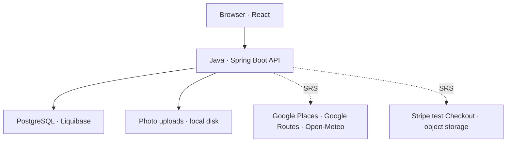
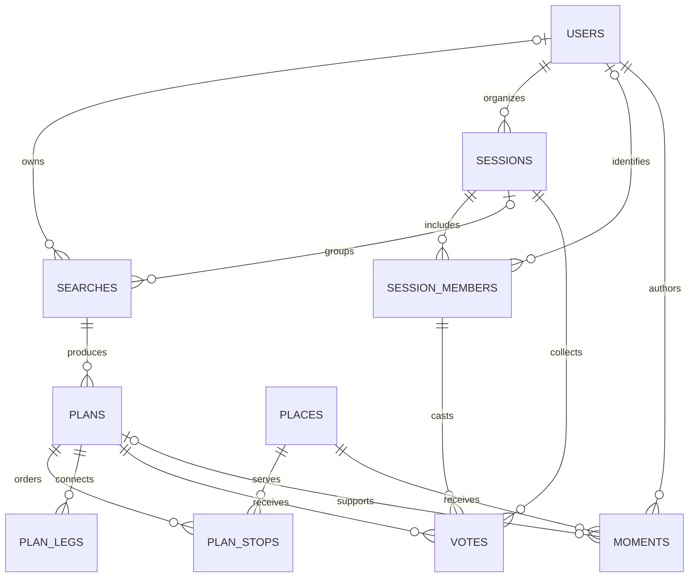

<p align="center"></p>
<h1 align="center">Hangout</h1>
<p align="center"><strong>Tonight, planned in under a minute.</strong></p>
<p align="center">Compare three door-to-door plans with travel time, an all-in cost estimate, and friends’ Moments, then vote on where to go.</p>
<p align="center">
  <a href="https://zimran-project.vercel.app">Live app</a> |
  <a href="https://drive.google.com/file/d/1J3LzIt-o1u477TeSjgR0YFqOrYLgRANR/view?usp=share_link">Demo video (90 s)</a> |
  Pitch deck: <code>TODO: &lt;shareable pitch deck URL&gt;</code> |
  <a href="https://hangout-api-hfiy.onrender.com/swagger-ui.html">API docs</a> |
  SRS: <code>TODO: &lt;shareable SRS URL&gt;</code>
</p>

## Demo video

**[Watch the Hangout demo on Google Drive][demo]**

Demo data: seed places and Moments, AI-generated photos, Stripe in test mode.

The linked recording runs about 94 seconds and reaches the guest readiness screen. The six-step walkthrough below continues through voting, Moments, and Plus. The Stripe label refers to the intended test mode. This build simulates upgrades.

## Table of contents

[Problem and idea](#the-problem-and-the-idea) · [How it works](#how-it-works) · [Key features](#key-features) · [Why it works](#why-it-works) · [Feature status](#feature-status)<br>
[Architecture](#architecture) · [API](#api-overview) · [Quick start](#quick-start) · [Environment](#environment-variables) · [Demo flow](#demo-accounts-and-demo-flow)<br>
[Testing](#testing) · [Judge review](#for-judges-a-3-minute-review-path) · [Security](#security-and-privacy) · [Limitations](#limitations-and-honesty) · [Structure](#project-structure) · [Docs and team](#docs-team-and-license)

## The problem and the idea

Hangout is a Business Cup 2.0 MVP for the Zimran Entertainment case.<br>
It is for adults aged 25–45 planning a night out as a couple or small group.<br>
Choosing a place takes time when people want different things or have different budgets.<br>
Menu prices leave out costs such as tax, tip, and travel.<br>
Hangout puts those estimates and a round-trip timeline on each plan, with friends’ Moments where available.<br>
Guests submit preferences privately and vote on the options the group can afford.

## How it works

1. **Search.** Set the group, start, time window, budget, and mood. Compare up to three plans.
2. **Invite.** Send a link. Guests join without an account and submit their budget and preferences.
3. **Vote.** The host generates group plans. Members vote, and the host closes voting.
4. **Go.** Follow the winning plan or export it to a calendar.
5. **Post a Moment.** Add a photo, a rating, and what you spent.

## Key features

| Feature | What it does | Where in code |
| --- | --- | --- |
| Plan search | Ranks plans from place, mood, time, budget, and travel inputs. | [PlanEngine.java][engine] |
| Timeline and all-in cost | Shows stops, return travel, and estimated place, tax, tip, and travel costs. | [Timeline.tsx][timeline] · [CostCalculator.java][cost] |
| Invite and vote | Builds plans for the group, tallies likes, and breaks ties by host preference and rank. | [SessionService.java][sessions] |
| Friends and Moments | Shows eligible friend signals while planning and supports a feed, place posts, and a map. | [FriendSignalService.java][signals] · [MomentService.java][moments] · [MapPage.tsx][map] |
| Plus | Redirects users to the paywall when they hit the free search quota. | [SearchPage.tsx][search-ui] · [SearchService.java][search] · [PlusPage.tsx][plus] |

## Why it works

1. **Filter.** Load nearby places from PostgreSQL. Screen for price, group needs, preference filters, and friend vetoes. A pinned place bypasses the initial candidate filters.
2. **Score.** Blend 70% place-type mood score with 30% Moment-tag frequency. The ranking also weighs rating, friend signals, budget fit, travel time, and discovery.
3. **Build a plan.** Try one- to three-stop shapes using activities, dinner, and treats. Check visit hours at arrival and departure. Include the return leg and reject plans that exceed the time limit.
4. **Price.** Calculate all-in cost in integer cents as place estimates + sales tax + food and drink tip + travel. Try cheaper stops or a shorter plan when needed.
5. **Blend group inputs.** Use shared moods, or the two most common moods if there is no overlap. Take the shortest time and lowest per-person budget, and use the centroid as the group start. Keep the organizer’s start time and advanced filters.

The search stores a fixed seed for tie-breaking. Given the same effective inputs, data, and candidate order, plan assembly is deterministic. Shuffle changes the seed and excludes prior stops. Unit tests cover plan shapes, type scores, midnight opening hours, fallback travel, score weights, and cost arithmetic. See the [engine tests][engine-tests] for scope.

## Feature status

Statuses describe implementation in this checkout. See [Testing](#testing) for what was executed.

| Feature | Status | Notes |
| --- | --- | --- |
| Auth | Working | Email and password registration and login. Google sign-in also has a conditional path that needs client configuration. |
| Search | Working | Uses database-backed plan generation. Tight constraints can yield fewer than three plans. |
| Results and timeline | Working | Stops, clock times, return travel, shuffle, and stop swaps. |
| All-in cost | Working | Estimated group and per-person amounts with a line-item breakdown. |
| Invite, private budgets, and voting | Working | Guest joins, plan generation, polling, vote and final plan are implemented. Group rules differ from the full SRS. |
| Friends | Working | Requests, acceptance, removal, blocking, and eligible friend signals. |
| Moments | Working | Posts, photo upload, sharing controls, and feed. Uploads use local disk. |
| Verified visit | Partial | Checks the submitted plan ID, its place, and a window around stop departure. The check does not establish that the author owned or joined the plan. |
| Map | Working | Leaflet shows plan and Moment locations with OpenStreetMap tiles. The plan map connects stops with straight lines. |
| Plus paywall (402) | Working | The fourth monthly search on Free returns HTTP 402 with the default quota. The frontend handles the response. |
| Stripe test checkout | Not built | Checkout returns HTTP 502 even when a key is supplied. The webhook acknowledges and ignores its payload. |
| Simulated Plus upgrade | Working | The backend uses `DEMO_UPGRADE`. The frontend uses `VITE_DEMO_UPGRADE` to show the button. |
| Seed fallback | Working | Liquibase loads fictional places and Moments. A local travel formula works without API keys. |
| Google Places and Routes, weather, object storage | Not built | Provider settings or hooks exist for some integrations. Generation uses PostgreSQL and local route estimates, and uploads use disk. |

## Architecture



Solid lines show implemented paths. Dotted lines show planned integrations.

<details>
<summary>Main database tables</summary>

Selected foreign keys from the [Liquibase schema][schema].



</details>

| Layer | Stack | Source |
| --- | --- | --- |
| Web | React 19.3.1, TypeScript 7.0.2, Vite 8.3.8, Tailwind CSS 4.3.5, Leaflet 1.9.4 | [Lockfile](hangout-web/package-lock.json) |
| API | Java 21, Spring Boot 3.5.3, Maven 3.9.9 in Docker, springdoc 2.8.6 | [POM](hangout-api/pom.xml) · [Dockerfile](hangout-api/Dockerfile) |
| Data | PostgreSQL 16, Spring Boot-managed Liquibase | [Compose](docker-compose.yml) · [Schema][schema] |

**Key engineering decisions**

- **Rank plans on the API.** A fixed seed and explicit scoring rules support repeatable debugging. The resulting plan quality depends on the place data and weights.
- **Seed places in PostgreSQL and estimate travel locally.** The demo can run without Google keys. Hours and travel times inherit the limits of the seed data and formula.
- **Return a session view with status and aggregate plan data.** Member rows omit individual budgets and starts. Participants still see the shared meeting point and budget-derived plan details.
- **Keep provider secrets server-side.** The browser receives build-time public configuration. Deployments must supply their own signing and database credentials.
- **Store photos on disk.** This keeps the MVP deployable with one API service. Persistence depends on the host disk or a mounted volume.

## API overview

Base path: `/api/v1`. **Bearer** means a user JWT. **Member** means a valid `X-Member-Token` or a signed-in user who belongs to the session.

| Method | Path under `/api/v1` | Auth | Purpose |
| --- | --- | --- | --- |
| POST | `/auth/register`, `/auth/login` | Public | Create an account or sign in. |
| POST | `/searches`, `/searches/{id}/shuffle` | Bearer | Generate or refresh plans. |
| POST | `/plans/{id}/swap`, `/plans/{id}/save` | Bearer | Replace a stop or save a plan. |
| POST | `/sessions` | Bearer | Create a shareable session. |
| GET | `/sessions/{code}` | Invite code | Read shared session state. |
| POST | `/sessions/{code}/join` | Invite code | Join and receive a member token. |
| PUT | `/sessions/{code}/inputs`, `/sessions/{code}/votes` | Member | Submit preferences or votes. |
| POST | `/sessions/{code}/generate`, `/sessions/{code}/close` | Organizer membership | Generate group plans or pick a winner. |
| GET | `/sessions/{code}/calendar.ics` | Member | Export the winning plan. |
| GET | `/friends`, `/feed`, `/map/moments` | Bearer | Read friends, feed, or map pins. |
| GET | `/places/autocomplete`, `/places/{id}` | Bearer | Find a place or retrieve its details. |
| POST | `/uploads`, `/moments` | Bearer | Upload an image or publish a Moment. |
| POST | `/billing/checkout`, `/billing/demo-upgrade` | Bearer | Checkout stub or flag-controlled Plus simulation. |

[Deployed Swagger UI][swagger] · Local Swagger at `/swagger-ui.html` · OpenAPI JSON at `/v3/api-docs`<br>
SRS §7 REST API: `TODO: <shareable URL or repository path for SRS §7>`.

## Quick start

**Prerequisites:** Docker with the Compose plugin for the full stack. Docker builds with Java 21, Maven 3.9.9, and Node 22. The PostgreSQL image is version 16.

From a fresh checkout:

```bash
git clone --branch mvp https://github.com/Daiyr05/zimran_project.git
cd zimran_project
docker compose up --build
```

| Service | Local address |
| --- | --- |
| Web | http://localhost:3000 |
| API | http://localhost:8080/api/v1 |
| Swagger UI | http://localhost:8080/swagger-ui.html |
| PostgreSQL | `localhost:5433` |

Compose builds the frontend against the Java API, sets `GOOGLE_ENABLED=false`, and lets Liquibase apply schema and seed data. No front-end env file is needed for this path. `docker compose config --quiet` passed. Full startup is **unverified** in this environment because the Docker daemon was unavailable.

<details>
<summary>Run the backend and frontend separately</summary>

Use **JDK 21**, **Maven 3.9.9** to match the container, and **Node 22.22.2+ within major 22** to meet frontend lockfile engine constraints. From the repository root, start the database:

```bash
docker compose up -d db
```

In a second terminal, from the repository root:

```bash
cd hangout-api
DB_URL=jdbc:postgresql://localhost:5433/hangout GOOGLE_ENABLED=false mvn spring-boot:run
```

The API and Compose database use matching development defaults. The API defaults to port `8080`. In a third terminal, from the repository root:

```bash
cd hangout-web
cp .env.example .env.local
npm ci
VITE_USE_MOCKS=false npm run dev
```

The Vite dev server defaults to `http://localhost:5173`. Set `VITE_USE_MOCKS=true` to exercise the browser mocks instead. The separate-service launch and frontend dependency install are **unverified** in this environment.

</details>

Run `mvn test` from `hangout-api/` for backend tests. See [Testing](#testing) for frontend checks and results.

## Environment variables

See the [frontend template](hangout-web/.env.example) and [API configuration][config]. The examples below are placeholders or mode flags.

| Name | Purpose | Required | Example placeholder |
| --- | --- | --- | --- |
| `DB_URL`, `DB_USER`, `DB_PASSWORD` | Database connection | Set outside local defaults | `<jdbc-url>`, `<db-user>`, `<db-password>` |
| `JWT_SECRET` | API signing secret | Set for deployments | `<random-signing-secret>` |
| `PORT`, `TIME_ZONE`, `UPLOADS_DIR` | HTTP port, demo city time zone, upload directory | Optional | `<port>`, `<iana-time-zone>`, `<absolute-path>` |
| `PUBLIC_URL`, `FRONTEND_URL`, `CORS_ORIGINS` | Public API, frontend origin, allowed origins | Set for deployments | `<public-api-origin>`, `<web-origin>`, `<allowed-origins>` |
| `GOOGLE_ENABLED`, `GOOGLE_PLACES_API_KEY` | Places configuration hooks | No for seed mode | `false`, `<server-side-key>` |
| `GOOGLE_CLIENT_ID`, `VITE_GOOGLE_CLIENT_ID` | Opt in to Google sign-in on API and web | Optional | `<google-oauth-client-id>` |
| `STRIPE_SECRET_KEY` | Reserved Stripe credential | No. Checkout is a stub. | `<stripe-test-key>` |
| `DEMO_UPGRADE`, `VITE_DEMO_UPGRADE` | Enable simulation on API and show the button on web | Optional | `true` |
| `VITE_API_URL` | Browser’s API base URL | Set for deployments | `<public-api-origin>/api/v1` |
| `VITE_USE_MOCKS`, `VITE_TIME_ZONE` | Toggle browser mocks and set plan display time zone | Optional | `false`, `<iana-time-zone>` |

## Demo accounts and demo flow

Use `demo@hangout.test` with the demo password documented in [the API README’s seed section](hangout-api/README.md#demo-data-liquibase) or register a new demo account. Use a second browser profile as the guest.

1. Search for **Partner · tonight, 7 pm · 4 h · $120 · Playful + Cozy**.
2. Compare the plans and open the first timeline. Find all-in cost and any matching friend badge.
3. Copy the invite link. Join as a guest and submit a lower private budget.
4. Generate group plans, vote from both profiles, and close voting to reveal the winning plan.
5. Post a Moment using a demo photo, rating, and amount spent.
6. Open Plus. To exercise the quota, use a fresh Free account and make a fourth search in the same month. Simulate the upgrade if both flags are enabled.

## Testing

**Backend:** Run `mvn test` in `hangout-api/`. The two test classes cover cost arithmetic and engine rules. Execution is **unverified** here. The available JDK is version 8, Maven is unavailable, and the Docker daemon is stopped or inaccessible.

**Frontend:** In `hangout-web/`, run `npm ci`, `npm run lint`, and `npm run build`. These are install, lint, and compilation checks. The package has no automated test script. Lint and build are **unverified** here. The offline dependency install failed because packages were missing from the npm cache.

<details>
<summary>SRS §10.3 acceptance checklist</summary>

| ID | Acceptance criterion | Status |
| --- | --- | --- |
| AT-1 | Signup and three plans for two people, 4 h, $120, Playful + Cozy within 5 s. | not run |
| AT-2 | Each plan fits 4 h and every stop is open from arrival to departure. | not run |
| AT-3 | All-in cost equals place, tax, tip, and travel costs to the cent. | not run |
| AT-4 | A friend’s 5-star place appears in plan 1 with a badge. A 2-star place never appears. | not run |
| AT-5 | Fourth monthly search returns HTTP 402 and shows Plus. Search works after simulated upgrade. | not run |
| AT-6 | Account-free guest joins, enters inputs, and votes. Host sees updates within 3 s. | not run |
| AT-7 | Session responses omit other members’ budgets and individual start locations. | not run |
| AT-8 | A Moment with place sharing off appears on the author profile and friends’ feed, and stays off the place page. | not run |
| AT-9 | A Moment for a matching planned visit within seven days shows Verified visit. | not run |
| AT-10 | Search returns plans from seed data with Google disabled. | not run |
| AT-11 | All pages fit at 375 px without horizontal scrolling. | not run |

</details>

## For judges: A 3-minute review path

1. **0:00–1:00 · Plan generation.** Open [PlanEngine.java][engine]. Read `generate`, `candidates`, and `timeline`. Check [FallbackRoutesClient.java][fallback] for the seed-mode travel estimates.
2. **1:00–2:00 · Cost and tests.** Open [CostCalculatorTest.java][cost-test]. Follow the assertions into [CostCalculator.java][cost] and check [PlanEngineRulesTest.java][rules-test] for engine cases.
3. **2:00–3:00 · Group privacy.** Open [SessionService.java][sessions]. Read `generate` and `view`. Trace requests through [SessionController.java][session-api] and the [schema][schema].

## Security and privacy

- Passwords use BCrypt. Protected endpoints use stateless JWT authentication and a configured CORS allowlist.
- Controllers use Jakarta validation on request bodies such as signup, search, guest input, and votes.
- Session writes require membership. Only the organizer can generate group plans or close voting.
- Session member views omit individual budgets and start locations. Plan estimates can reflect the lowest submitted budget. A shared start is derived from submitted locations.
- Deployment secrets come from server-side environment variables. Vite variables are public to the browser.

## Limitations and honesty

- The demo covers one seed city, New York’s East Village. Places and Moments are seeded, and demo photos are AI-generated.
- The checked-in API uses seed places and fallback travel estimates. Live Google Places and Routes, their caching and usage costs, and Open-Meteo are outside the demonstrated flow.
- The Plus screen uses test-mode copy. Stripe Checkout and webhook processing are stubs. The app can simulate a tier change. There are no real payments or bookings.
- Group planning uses a single route from the shared meeting point. The SRS also calls for individual first and last legs, the latest submitted start, and merged member filters and energy.
- The Verified visit badge reflects a matching plan and posting window. See [Feature status](#feature-status) for its limits.

**Next steps from SRS §10.1:** Add a second city, implement real payments, and support bookings or reservations.

## Project structure

- `docker-compose.yml` — Full local stack.
- `hangout-api/` — Java and Spring Boot API.
  - `src/` — Application code, Liquibase migrations, and JUnit tests.
  - `pom.xml`, `Dockerfile`, `docker-compose.yml` — Maven and API container configuration.
- `hangout-web/` — React and Vite browser app.
  - `src/` — Pages, components, API clients, and mocks.
  - `public/` — Logo, demo photos, and mock service worker.
  - `.env.example`, `package.json`, `package-lock.json` — Configuration and dependencies.
  - `Dockerfile`, `nginx.conf`, `vercel.json` — Container and Vercel deployment configuration.

## Docs, team, and license

**In this repository:** [Frontend guide](hangout-web/README.md) · [Backend guide](hangout-api/README.md) · [Source repository](https://github.com/Daiyr05/zimran_project).

**In the separate Business Cup workspace:**

| Document | Contents |
| --- | --- |
| `docs/CASE.md` | Competition brief and judging criteria. |
| `docs/PITCH.md` | Pitch preparation checklist. |
| `docs/VIDEO.md`, `docs/video.srt` | Planned demo narration and subtitles. |
| `docs/STATUS.md` | Team work log. |
| `docs/SKILLS.md` | Project playbook index. |
| `docs/slides-2-3.md` | Draft problem and alternatives slides. |
| `docs/Zimran — контекст для команды и агентов.md` | Zimran background notes. |

| Team member | Role |
| --- | --- |
| Daiyrbek | Backend and Java plan engine |
| Zhandaulet | Frontend and React |
| Alikhan | Pitch, demo, and validation |

**License:** `TODO: <license for the Hangout product repository>`. The separate Business Cup workspace contains an MIT license. This product checkout has no LICENSE file.

[demo]: https://drive.google.com/file/d/1J3LzIt-o1u477TeSjgR0YFqOrYLgRANR/view?usp=share_link
[swagger]: https://hangout-api-hfiy.onrender.com/swagger-ui.html
[engine]: hangout-api/src/main/java/com/hangout/api/engine/PlanEngine.java
[cost]: hangout-api/src/main/java/com/hangout/api/engine/CostCalculator.java
[fallback]: hangout-api/src/main/java/com/hangout/api/engine/FallbackRoutesClient.java
[sessions]: hangout-api/src/main/java/com/hangout/api/session/SessionService.java
[session-api]: hangout-api/src/main/java/com/hangout/api/session/SessionController.java
[signals]: hangout-api/src/main/java/com/hangout/api/search/FriendSignalService.java
[search]: hangout-api/src/main/java/com/hangout/api/search/SearchService.java
[moments]: hangout-api/src/main/java/com/hangout/api/moment/MomentService.java
[schema]: hangout-api/src/main/resources/db/changelog/001-schema.sql
[config]: hangout-api/src/main/resources/application.yml
[engine-tests]: hangout-api/src/test/java/com/hangout/api/engine
[cost-test]: hangout-api/src/test/java/com/hangout/api/engine/CostCalculatorTest.java
[rules-test]: hangout-api/src/test/java/com/hangout/api/engine/PlanEngineRulesTest.java
[timeline]: hangout-web/src/features/plans/Timeline.tsx
[map]: hangout-web/src/pages/MapPage.tsx
[plus]: hangout-web/src/pages/PlusPage.tsx
[search-ui]: hangout-web/src/pages/SearchPage.tsx
